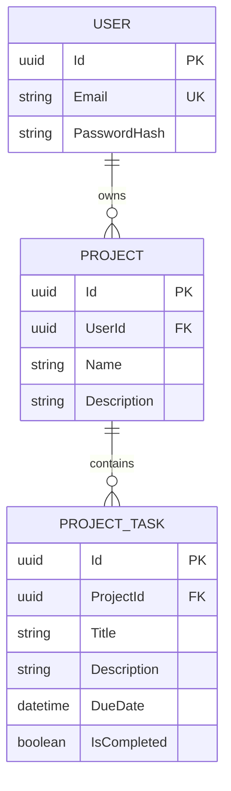

# ProjectTracker API

ProjectTracker API is a secure, multi-user REST API for organizing projects and their tasks. It demonstrates a practical ASP.NET Core backend with JWT authentication, per-user data isolation, EF Core persistence, input validation, automated tests, interactive OpenAPI documentation, and a repeatable Postman workflow.

## Business purpose

The API gives each registered user a private project workspace. A user can create and maintain projects, add due-dated tasks, mark work complete, and retrieve only their own data. It is intended as a focused backend for individual project planning and as a portfolio example of authentication, authorization, relational modeling, and testable service design.

## Main capabilities

- Register and sign in with email and password.
- Receive a signed JWT for authenticated requests.
- Create, list, update, and delete owned projects.
- Add and list tasks within an owned project.
- Update and delete owned tasks without exposing another user's resources.
- Validate request data before it reaches application logic.
- Explore and authorize requests through Swagger UI in Development.
- Run the complete API workflow from a self-contained Postman collection.

## Technology stack

Versions are taken from the project files.

| Area | Technology | Version |
| --- | --- | --- |
| Runtime and web framework | .NET / ASP.NET Core | `net10.0` |
| Data access | Entity Framework Core SQL Server and Design | 10.0.2 |
| Database | Microsoft SQL Server | Local instance required |
| Authentication | ASP.NET Core JWT Bearer | 10.0.2 |
| Password hashing | BCrypt.Net-Next | 4.0.3 |
| API documentation | Swashbuckle.AspNetCore | 10.1.0 |
| OpenAPI integration | Microsoft.AspNetCore.OpenApi | 10.0.2 |
| OpenAPI object model | Microsoft.OpenApi | 2.3.0 |
| Unit testing | xUnit / xUnit VS runner | 2.9.3 / 3.1.4 |
| API integration testing | Microsoft.AspNetCore.Mvc.Testing | 10.0.2 |
| Test data provider | EF Core InMemory | 10.0.2 |
| Test and coverage tooling | Microsoft.NET.Test.Sdk / coverlet.collector | 17.14.1 / 6.0.4 |

## Architecture

- **Controllers** define the HTTP contract. `AuthController` handles registration and login, while the protected project and task controllers translate requests and service results into HTTP responses.
- **Services** contain project/task operations, ownership checks, JWT creation, and authenticated-user lookup. Project and task access is filtered by the current user's identifier so cross-user resources are not disclosed.
- **EF Core `AppDbContext`** maps users, projects, and tasks, and supplies asynchronous database access.
- **SQL Server** stores application data. The included EF Core migration creates the schema, unique email index, foreign keys, and cascade delete from projects to tasks.
- **JWT Bearer authentication** validates the token signature, issuer, audience, and lifetime before protected controllers run. Registration and login are the only anonymous endpoints.

### Data model



`PROJECT_TASK` represents the `ProjectTask` entity stored in the `Tasks` table.

## Project structure

```text
.
├── ProjectTracker.Api/
│   ├── Controllers/          # Authentication, project, and task endpoints
│   ├── Data/                 # EF Core DbContext
│   ├── Dtos/                 # Request and response contracts
│   ├── Migrations/           # Versioned SQL Server schema
│   ├── Models/               # User, Project, and ProjectTask entities
│   ├── Options/              # Validated JWT configuration model
│   ├── Properties/           # Local launch profiles
│   ├── Services/             # JWT, user context, and business operations
│   ├── Program.cs            # Composition root and middleware pipeline
│   └── ProjectTracker.Api.http
├── ProjectTracker.Tests/     # xUnit service, security, and API tests
├── postman/
│   └── ProjectTracker-API.postman_collection.json
├── ProjectTracker.slnx
├── .gitignore
└── README.md
```

## Prerequisites

- [.NET 10 SDK](https://dotnet.microsoft.com/download/dotnet/10.0)
- A local SQL Server instance
- EF Core CLI 10.x (`dotnet-ef`) to apply migrations
- Postman, if you want to run the supplied API workflow

The repository intentionally contains no runnable database credential or JWT signing key. Supply both outside Git before starting the API.

## Local setup

### 1. Configure SQL Server

Use an empty development database, or allow the included migration to create `ProjectTrackerDb` with an account that has permission to do so. This Windows-authentication example targets SQL Server Express:

```text
Server=localhost\SQLEXPRESS;Database=ProjectTrackerDb;Trusted_Connection=True;TrustServerCertificate=True;
```

Replace `localhost\SQLEXPRESS` when your SQL Server instance has a different name. Do not commit a connection string containing credentials.

### 2. Configure user secrets in Windows PowerShell

The API project already contains a non-secret `UserSecretsId`. From the repository root, set the required local values:

```powershell
$apiProject = '.\ProjectTracker.Api\ProjectTracker.Api.csproj'

dotnet user-secrets set "ConnectionStrings:DefaultConnection" "Server=localhost\SQLEXPRESS;Database=ProjectTrackerDb;Trusted_Connection=True;TrustServerCertificate=True;" --project $apiProject

$jwtBytes = New-Object byte[] 48
$rng = [Security.Cryptography.RandomNumberGenerator]::Create()
$rng.GetBytes($jwtBytes)
$jwtKey = [Convert]::ToBase64String($jwtBytes)
$rng.Dispose()

dotnet user-secrets set "Jwt:Key" $jwtKey --project $apiProject
Remove-Variable jwtBytes
Remove-Variable jwtKey
Remove-Variable rng
```

If `UserSecretsId` is absent in a fork or a fresh project, initialize it once with `dotnet user-secrets init --project .\ProjectTracker.Api\ProjectTracker.Api.csproj` before setting values.

The generated signing value contains 48 random bytes before Base64 encoding and satisfies the API's minimum key length. `Jwt:Issuer`, `Jwt:Audience`, and `Jwt:ExpirationMinutes` have non-secret defaults in `appsettings.json` and may also be overridden with user secrets.

### Environment-variable alternative

Environment variables are useful for a temporary shell session or another host that supplies its own secret store:

```powershell
$env:ConnectionStrings__DefaultConnection = 'Server=localhost\SQLEXPRESS;Database=ProjectTrackerDb;Trusted_Connection=True;TrustServerCertificate=True;'
$jwtBytes = New-Object byte[] 48
$rng = [Security.Cryptography.RandomNumberGenerator]::Create()
$rng.GetBytes($jwtBytes)
$env:Jwt__Key = [Convert]::ToBase64String($jwtBytes)
$rng.Dispose()
Remove-Variable jwtBytes
Remove-Variable rng

$env:Jwt__Issuer = 'ProjectTracker'
$env:Jwt__Audience = 'ProjectTracker'
$env:Jwt__ExpirationMinutes = '480'
```

ASP.NET Core reads the double-underscore names as nested configuration keys. These variables apply to the current PowerShell session and its child processes. ASP.NET Core does **not** load `.env` files automatically; no `.env` loader is included in this project.

### 3. Apply the EF Core migration

After configuration is available:

```powershell
dotnet ef database update --project .\ProjectTracker.Api\ProjectTracker.Api.csproj --startup-project .\ProjectTracker.Api\ProjectTracker.Api.csproj
```

The existing `InitialCreate` migration is retained in source control.

### 4. Start the API

```powershell
dotnet restore .\ProjectTracker.slnx
dotnet run --project .\ProjectTracker.Api\ProjectTracker.Api.csproj --launch-profile http
```

The launch profiles expose:

| Profile | API URL | Swagger UI |
| --- | --- | --- |
| `http` | `http://localhost:5083` | `http://localhost:5083/swagger` |
| `https` | `https://localhost:7061` and `http://localhost:5083` | `https://localhost:7061/swagger` |

Swagger is enabled only when the application environment is `Development`; both checked-in launch profiles set that environment for local use.

## Tests and quality checks

Run the solution checks from the repository root:

```powershell
dotnet restore .\ProjectTracker.slnx
dotnet build .\ProjectTracker.slnx --configuration Release --no-restore
dotnet test .\ProjectTracker.slnx --configuration Release --no-build
dotnet format .\ProjectTracker.slnx --verify-no-changes --no-restore
```

To produce local coverage output:

```powershell
dotnet test .\ProjectTracker.slnx --collect:"XPlat Code Coverage"
```

`TestResults` and coverage output are ignored by Git.

## Postman

Import [`postman/ProjectTracker-API.postman_collection.json`](postman/ProjectTracker-API.postman_collection.json) into Postman, start the API with the `http` launch profile, and run the entire collection from its first request.

The collection defaults `baseUrl` to `http://localhost:5083` and executes this workflow:

1. Register
2. Login
3. Create project
4. List projects
5. Update project
6. Add task
7. List tasks
8. Update task
9. Delete task
10. Delete project

At the start of each collection run, the Register pre-request script clears prior token and resource identifiers and generates a unique fictional `@example.test` email plus a validation-compliant password. Tests capture the token, `projectId`, and `taskId` and assert expected statuses and important response fields. Cleanup deletes the task before its project, so the collection can run repeatedly without editing data by hand.

If the API uses another address, change the collection-level `baseUrl` variable before running it. Register and Login use No Auth; the remaining requests inherit collection-level Bearer authentication from `{{token}}`.

## API endpoints

All request and response bodies use JSON. Protected requests require `Authorization: Bearer <token>`.

| Method | Route | Authentication | Purpose |
| --- | --- | --- | --- |
| `POST` | `/auth/register` | Public | Create a user and return a JWT |
| `POST` | `/auth/login` | Public | Verify credentials and return a JWT |
| `POST` | `/projects` | Bearer JWT | Create a project for the current user |
| `GET` | `/projects` | Bearer JWT | List the current user's projects |
| `PUT` | `/projects/{id}` | Bearer JWT | Update an owned project |
| `DELETE` | `/projects/{id}` | Bearer JWT | Delete an owned project and its tasks |
| `POST` | `/projects/{projectId}/tasks` | Bearer JWT | Add a task to an owned project |
| `GET` | `/projects/{projectId}/tasks` | Bearer JWT | List tasks in an owned project |
| `PUT` | `/tasks/{taskId}` | Bearer JWT | Update a task in an owned project |
| `DELETE` | `/tasks/{taskId}` | Bearer JWT | Delete a task in an owned project |

## Security behavior

- Registration and login are public; every project and task endpoint requires a valid JWT.
- JWT validation checks issuer, audience, lifetime, signature, and an explicit one-minute clock skew.
- Startup validation fails clearly when the database connection or required JWT configuration is absent or invalid.
- The JWT signing key must be at least 32 bytes and is never supplied as a functioning committed default.
- Project and task queries enforce ownership. Missing and cross-user resources return the same not-found behavior to avoid revealing whether another user's resource exists.
- Invalid or missing user identifier claims produce an unauthorized response rather than an unhandled parsing exception.
- New passwords use BCrypt.Net's SHA-384 enhanced hashing mode so the full validated password is incorporated; verification remains compatible with existing plain-BCrypt hashes. Passwords are never stored as plaintext.
- Request DTO validation requires valid emails up to 254 characters and passwords of 8–128 characters. Project names and task titles are required, trimmed, and limited to 200 characters; optional descriptions are normalized safely and limited to 2,000 characters. Invalid requests receive HTTP 400 responses.

## Configuration reference

Configuration follows standard ASP.NET Core precedence, so user secrets and environment variables override `appsettings.json`.

| Configuration key | Environment variable | Committed default | Requirement |
| --- | --- | --- | --- |
| `ConnectionStrings:DefaultConnection` | `ConnectionStrings__DefaultConnection` | None | Required SQL Server connection string |
| `Jwt:Key` | `Jwt__Key` | None | Required signing key of at least 32 UTF-8 bytes |
| `Jwt:Issuer` | `Jwt__Issuer` | `ProjectTracker` | Required token issuer |
| `Jwt:Audience` | `Jwt__Audience` | `ProjectTracker` | Required token audience |
| `Jwt:ExpirationMinutes` | `Jwt__ExpirationMinutes` | `480` | Required token lifetime from 1 through 10,080 minutes |

Do not put production credentials or signing keys in `appsettings*.json`, the Postman collection, HTTP examples, or source code.

## Current limitations

- A local SQL Server instance is required; there is no embedded or containerized database setup.
- There are no refresh tokens or password-reset flows.
- There is no rate limiting.
- There is no frontend.
- There is no CI/CD or deployment configuration yet.
- This is a local portfolio project, not a production deployment.

## Portfolio highlights

This repository demonstrates:

- Secure external configuration with fail-fast startup validation and typed JWT options.
- JWT authentication and BCrypt enhanced password hashing without a committed runnable secret.
- User-scoped authorization enforced in EF Core queries.
- Thin project/task controllers backed by focused services rather than redundant repository abstractions.
- Async EF Core operations, read-only query optimization, and cancellation support.
- Declarative request validation and controlled authentication failures.
- Automated coverage for ownership boundaries, transformation rules, JWT claims, DTO validation, and important service/API behavior.
- Development-only Swagger with Bearer-token support.
- A repeatable Postman collection with generated test identities, captured variables, assertions, and cleanup.
- Repository hygiene that excludes reproducible builds, local secrets, logs, test results, and editor artifacts while retaining migrations and source.
